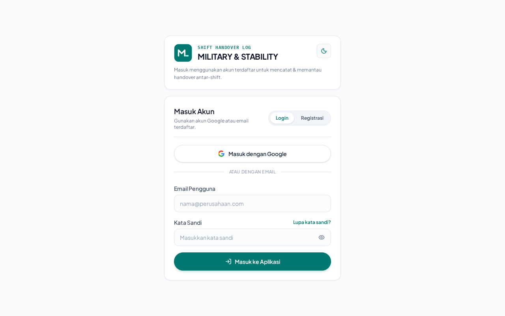
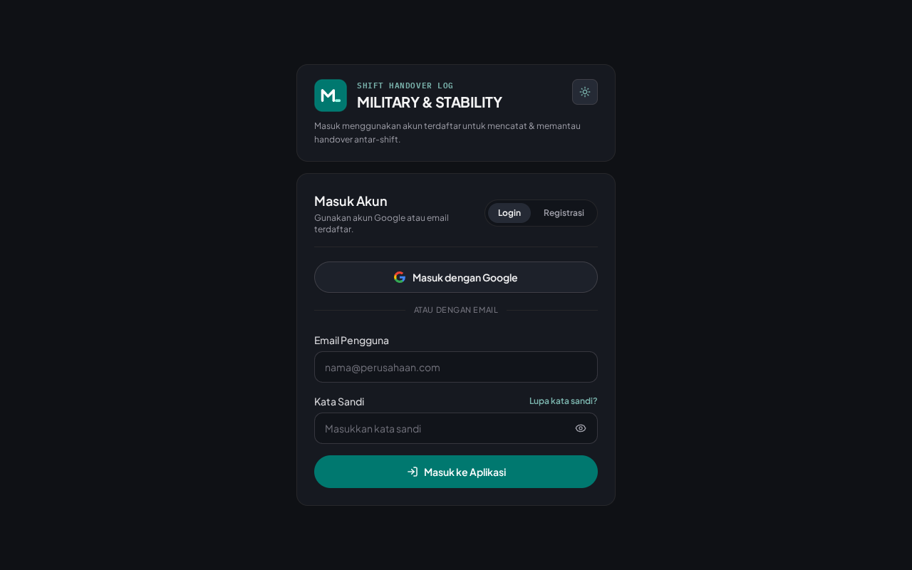
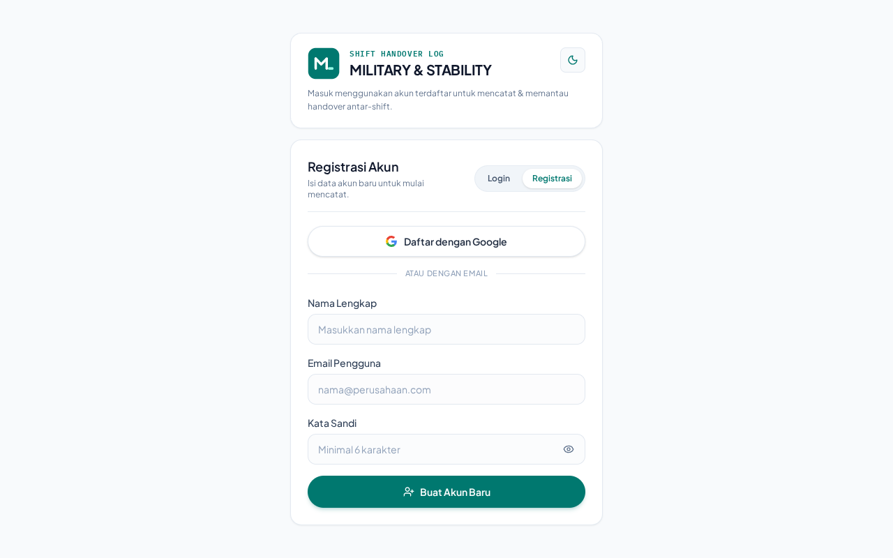

# MILITARY & STABILITY — Shift Handover

Aplikasi web pencatatan dan penerusan laporan pekerjaan mesin antar-shift produksi (*Shift 1, Shift 2, Shift 3*) berbasis **Firebase Authentication** dan **Cloud Firestore** dengan ekspor laporan Excel (`.xlsx`).

---

## Tampilan Aplikasi

### Halaman Masuk (Tema Terang & Tema Gelap)
Mendukung login menggunakan akun **Google** maupun **Email & Kata Sandi**, serta tombol pengalih tema terang/gelap yang nyaman di mata.

| Tema Terang | Tema Gelap |
| :---: | :---: |
|  |  |

### Halaman Registrasi Akun
Pengguna baru dapat mendaftar mandiri lewat Google atau email sebelum dikonfirmasi oleh Admin.



---

## Fitur Utama

- **Dashboard Shift Berjalan**: Memantau seluruh mesin aktif lintas shift (*carry-over* otomatis untuk kasus yang belum selesai), lengkap dengan total durasi shift kerja, status uji, dan detail line bocor.
- **Form Laporan Terstruktur (SOP 4 Tahap)**:
  1. **OH** — Mesin sedang overhaul / belum mulai perbaikan.
  2. **Perbaikan** — Catatan perbaikan & setting mesin.
  3. **Military** — Pencatatan pengambilan palet (*Belum Diuji*, *OK 0%*, atau *Gagal, bocor* beserta jumlah box dan line/nozzle bocor).
  4. **Stability** — Uji stabilitas (*4 Jam*, *8 Jam*, atau keduanya untuk Overhaul) hingga siap produksi.
- **Salin Tindak Lanjut Cepat**: Tombol **Salin dari Shift Sebelumnya** mengisi otomatis rencana tindak lanjut terakhir mesin yang masih berlanjut hanya dengan satu ketuk.
- **Riwayat & Pencarian**: Filter laporan berdasarkan tanggal, shift, kategori, status (*Berlanjut / Selesai OK*), dan kata kunci (termasuk pencarian nama mesin atau line bocor).
- **Ekspor Excel (`.xlsx`)**: Unduh rekap laporan terformat lengkap dengan kolom durasi shift, jumlah Military, jumlah Stability, serta line bocor.
- **Hak Akses Berbasis Role**:
  - **Pengawas**: Input shift berjalan (+4 jam masa tenggang) & edit laporan sendiri.
  - **Supervisor**: Input/edit lintas shift & kelola riwayat laporan.
  - **Admin**: Konfirmasi pengguna baru, atur role & izin edit, serta kelola data.

---

## Cara Menggunakan Secara Singkat

1. **Masuk / Daftar**: Buka aplikasi lalu masuk dengan Google atau buat akun baru pada tab **Registrasi**. Pengguna baru menunggu persetujuan Admin terlebih dahulu.
2. **Pantau Dashboard**: Lihat daftar mesin per kategori (**OVERHAUL**, **STABILITY TINGGI**, **CASE PERBAIKAN PART**, **COMMISSIONING / TRIAL / CHANGE OVER**). Ketuk kartu laporan untuk melihat detail & kronologi kasus.
3. **Catat / Lanjutkan Laporan**: Klik **Isi Shift** atau **Tambah**, pilih kategori dan mesin. Tahap kerja, nomor Military, lokasi palet, dan tombol **Salin dari Shift Sebelumnya** pada kolom Tindak Lanjut otomatis mengikuti riwayat mesin tersebut.
4. **Selesaikan Kasus**: Centang **Tandai Mesin Selesai (OK / Siap Produksi)** saat uji akhir dinyatakan lulus agar kasus ditutup setelah pergantian hari operasional.
5. **Ekspor Laporan**: Buka menu **Ekspor** untuk mengunduh file Excel sesuai rentang tanggal atau filter yang dibutuhkan.

---

## Teknologi

- **Frontend**: React 19, TypeScript, Vite, Tailwind CSS v4, Lucide Icons
- **Backend & Database**: Firebase Authentication & Cloud Firestore
- **Ekspor Dokumen**: `xlsx-js-style`

---

## Perintah Pengembangan

```bash
npm install
npm run dev       # Jalankan server lokal di port 3000
npm run lint      # Pemeriksaan TypeScript
npm run build     # Build produksi
```
